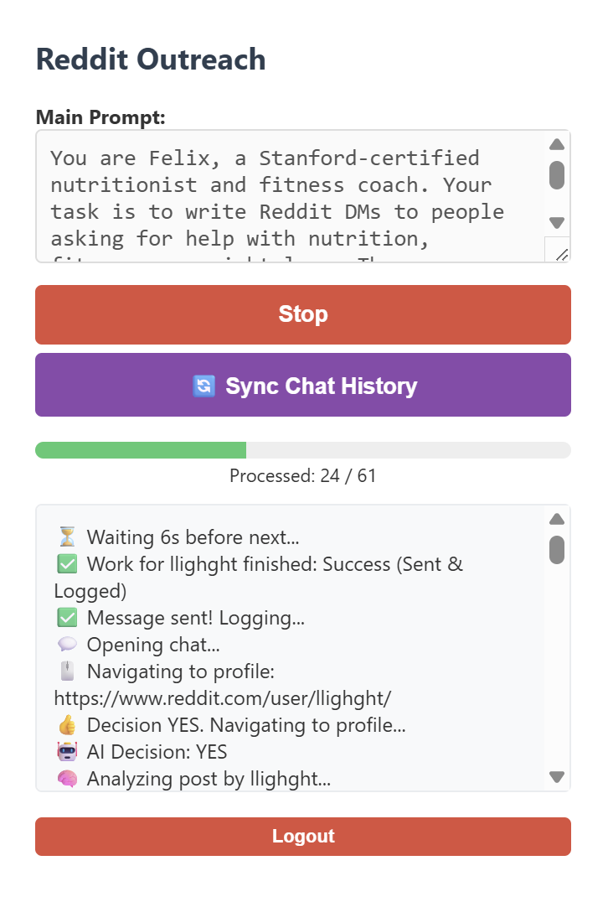
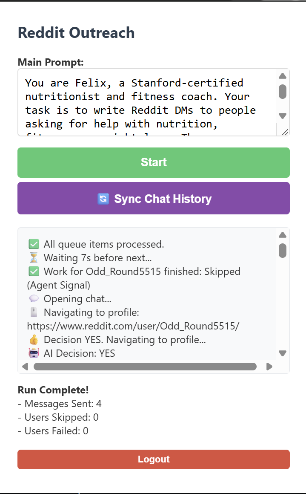
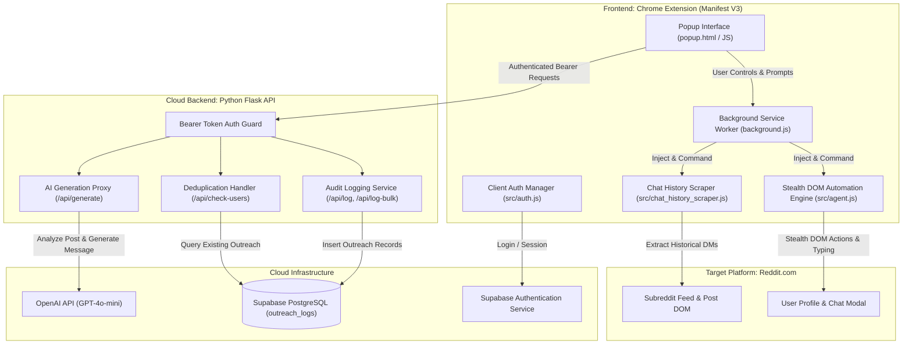
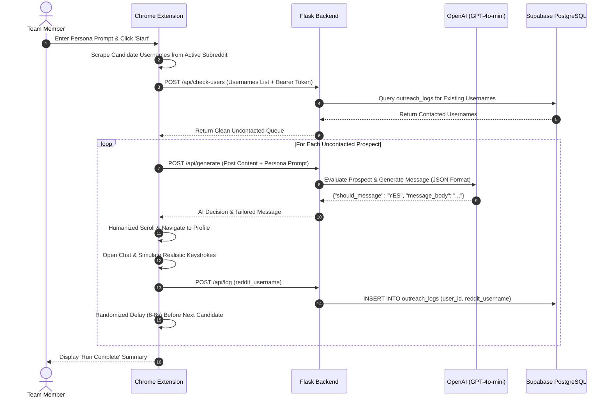

# Reddit Outreach Automation V2

<p align="center">
  <em>An enterprise-grade Chrome extension and cloud-coordinated backend suite for high-precision, persona-driven Reddit outreach and automated prospect engagement.</em>
</p>

<p align="center">
  
  
  
  
  
  <a href="LICENSE"></a>
  
</p>

> [!IMPORTANT]
> **Live Production System:** The backend is deployed and fully active on cloud infrastructure. Team members can simply load the Chrome extension and start outreach immediately without setting up local servers or databases.

---

## Visual Proof & Live Interface

<p align="center">
  
  
</p>

<p align="center">
  <sub><strong>Left:</strong> Live real-time prospecting in action (processing candidate queue with dynamic progress bar and real-time execution log stream).<br>
  <strong>Right:</strong> Completed outreach session audit summary reporting messages sent, skipped users, and zero-failure execution.</sub>
</p>

---

## Overview & Key Features

Reddit Outreach Automation V2 solves the manual friction and duplication challenges of outbound messaging on Reddit. By pairing browser-level DOM intelligence with a centralized cloud backend, marketing and business development teams can scale outreach while maintaining natural conversational quality.

### Flagship Capabilities
- 🎯 **Persona-Driven AI Qualification**: Uses OpenAI GPT-4o-mini to inspect Reddit posts, filter candidates based on a customizable target persona prompt, and generate contextual, personalized opening messages.
- 🥷 **Stealth Human-Like DOM Automation**: Content scripts simulate human interaction with randomized coordinate click jitter (`±2px`), smooth Bezier scrolling, organic mouse event chains (`mouseover` &rarr; `mousedown` &rarr; `mouseup` &rarr; `click`), and React-safe typing intervals.
- 🛡️ **Team-Wide Deduplication**: Every outreach event is recorded in a shared Supabase PostgreSQL database. Before messaging, candidate usernames are checked against team logs to guarantee prospects are never contacted twice.
- 🔄 **Retroactive Chat History Synchronization**: A dedicated scraper scans existing Reddit chat threads in one click and registers past contacts into Supabase to prevent duplicate messaging of prior conversations.
- 🔐 **Token-Based Authentication**: Operators log in securely using Supabase Auth directly inside the extension popup; every backend API request requires a verified Bearer token.
- ⚡ **Manifest V3 Architecture**: Built on Google Chrome's latest extension standard, utilizing background service workers and lightweight script injection.

---

## System Architecture



---

## Execution Flow



---

## Quickstart (Team Members)

> [!NOTE]
> The backend is already hosted and pre-configured. Team members do **not** need to install Python or set up local databases.

### 1. Load the Extension
1. Open Google Chrome and navigate to `chrome://extensions/`.
2. Enable **Developer mode** using the toggle in the top-right corner.
3. Click the **Load unpacked** button.
4. Select the `browser_extension` folder from this repository.

### 2. Authenticate
1. Click the **Reddit Outreach** icon in your Chrome toolbar.
2. Sign in with your team credentials (or click **Sign Up** if creating a new account).

### 3. Run Automated Outreach
1. Navigate to your target subreddit (e.g. `reddit.com/r/nutrition` or `reddit.com/r/webdev`).
2. Open the extension popup.
3. Enter your custom qualification persona in the **Main Prompt** field:
   ```text
   You are Felix, a Stanford-certified nutritionist and fitness coach. Your task is to write Reddit DMs to people asking for help with nutrition and workout plans.
   ```
4. Click **Start**. The extension will automatically scan the feed, qualify prospects with AI, and initiate direct messages.
5. Click **Stop** at any point to pause execution safely.

### 4. Sync Prior Chat History
When viewing your Reddit chat inbox (`reddit.com/chat`), click **Sync Chat History** in the popup. The extension will automatically ingest your existing chat conversations into Supabase so those users are never messaged again.

---

## Developer & Self-Hosting Guide

If you wish to self-host the backend or run a local development environment:

### 1. Prerequisites
- **Python 3.10+**
- **Supabase Project** (Database & Auth)
- **OpenAI API Key** (with GPT-4o-mini access)

### 2. Backend Local Setup
```bash
# Navigate to backend directory
cd backend

# Create and activate virtual environment
python -m venv venv
source venv/bin/activate  # On Windows: .\venv\Scripts\activate

# Install dependencies
pip install -r requirements.txt

# Configure environment variables
cp .env.example .env
```

Populate `backend/.env` with your credentials:
```env
OPENAI_API_KEY=sk-your-openai-api-key
SUPABASE_URL=https://your-project.supabase.co
SUPABASE_KEY=your-supabase-service-role-key
```

Run the development server:
```bash
python app.py
```
The API will be available at `http://localhost:5000`.

### 3. Configure Extension for Local Development
1. Open `browser_extension/config.js` (or copy from `config.example.js`).
2. Set the `BACKEND_URL`:
   ```javascript
   export const BACKEND_URL = "http://localhost:5000";
   ```
3. Reload the extension in `chrome://extensions/`.

### 4. Deploying to Cloud (Render / Railway)
1. Link your GitHub repository to [Render](https://render.com) or [Railway](https://railway.app).
2. Configure build and start commands:
   - **Build Command**: `pip install -r backend/requirements.txt`
   - **Start Command**: `gunicorn backend.app:app`
3. Add environment variables (`OPENAI_API_KEY`, `SUPABASE_URL`, `SUPABASE_KEY`) in the provider dashboard.
4. Update `browser_extension/config.js` with your production backend URL.

---

## API Reference

The Flask backend exposes the following REST endpoints:

| Endpoint | Method | Auth | Description | Payload Sample |
| :--- | :---: | :---: | :--- | :--- |
| `/` | `GET` | No | Health check & service identification | `None` |
| `/api/check-users` | `POST` | Bearer | Filters out users already messaged | `{"usernames": ["user1", "user2"]}` |
| `/api/generate` | `POST` | Bearer | AI prospect evaluation & DM copy generation | `{"post_content": "...", "main_prompt": "..."}` |
| `/api/log` | `POST` | Bearer | Records a single completed outreach event | `{"reddit_username": "username"}` |
| `/api/log-bulk` | `POST` | Bearer | Bulk logs multiple usernames (chat sync) | `{"usernames": ["u1", "u2", "u3"]}` |

---

## Supabase Database Schema

The database utilizes Supabase PostgreSQL with Row Level Security (RLS). Execute the following schema in your Supabase SQL Editor:

```sql
-- Table: outreach_logs
CREATE TABLE IF NOT EXISTS public.outreach_logs (
    id UUID DEFAULT gen_random_uuid() PRIMARY KEY,
    user_id UUID NOT NULL REFERENCES auth.users(id) ON DELETE CASCADE,
    reddit_username TEXT NOT NULL,
    created_at TIMESTAMP WITH TIME ZONE DEFAULT timezone('utc'::text, now()) NOT NULL,
    UNIQUE(user_id, reddit_username)
);

-- Enable Row Level Security
ALTER TABLE public.outreach_logs ENABLE ROW LEVEL SECURITY;

-- Policies for Authenticated Operators
CREATE POLICY "Users can view their own outreach logs"
    ON public.outreach_logs FOR SELECT
    USING (auth.uid() = user_id);

CREATE POLICY "Users can insert their own outreach logs"
    ON public.outreach_logs FOR INSERT
    WITH CHECK (auth.uid() = user_id);
```

---

## Configuration Reference

### Backend (`backend/.env`)

| Variable | Description | Source |
| :--- | :--- | :--- |
| `OPENAI_API_KEY` | Secret key for GPT-4o-mini qualification | [OpenAI Platform](https://platform.openai.com) |
| `SUPABASE_URL` | Project API URL | [Supabase Settings > API](https://supabase.com) |
| `SUPABASE_KEY` | Service Role secret key (bypasses RLS on backend) | [Supabase Settings > API](https://supabase.com) |

### Extension (`browser_extension/config.js`)

| Constant | Description | Value |
| :--- | :--- | :--- |
| `SUPABASE_URL` | Public API URL of your Supabase instance | `https://your-project.supabase.co` |
| `SUPABASE_ANON_KEY` | Public anonymous client key | Safe for client-side inclusion |
| `BACKEND_URL` | Deployed Flask backend URL | Production or `http://localhost:5000` |

---

## Repository Structure

```text
Eylo-Reddit-v2/
├── assets/                       # UI screenshots and documentation media
│   ├── extension_active_run.png  # Live execution capture (progress bar & log stream)
│   └── extension_run_complete.png# Run complete summary & statistics
├── backend/                      # Python Flask API & database integration
│   ├── app.py                    # Flask server, OpenAI proxy & Supabase handler
│   ├── requirements.txt          # Python dependencies (Flask, Supabase, OpenAI)
│   ├── supabase_schema.sql       # PostgreSQL DDL schema & security policies
│   └── .env.example              # Environment variables template
├── browser_extension/            # Chrome Extension (Manifest V3)
│   ├── manifest.json             # Extension manifest specification
│   ├── background.js             # Service worker managing tabs and messages
│   ├── popup.html                # User interface modal
│   ├── popup.js                  # Frontend controllers and log renderers
│   ├── content_script.js         # Content script bridge
│   ├── config.example.js         # Client-side configuration template
│   ├── images/                   # Extension icons (16px, 48px, 128px)
│   └── src/                      # Modular extension services
│       ├── agent.js              # Stealth DOM navigation & typing automation
│       ├── auth.js               # Supabase Auth manager
│       ├── chat_history_scraper.js# Reddit DM retro-synchronizer
│       ├── inspector.js          # Post scraper & DOM extractor
│       └── supabase_client.js    # Direct client-side Supabase SDK
├── .agent/rules/                 # Project-specific AI governance & architecture rules
├── docs/                         # Project documentation and architectural slides
│   ├── Eylo_AI_Reddit_Automation.pdf
│   ├── Eylo_AI_Reddit_Automation.pptx
│   ├── DEPLOY.md                 # Cloud deployment instructions
│   └── use.md                    # End-user operational guide
├── AGENTS.md                     # Living workspace governance contract
├── LICENSE                       # MIT License
├── README.md                     # Portfolio landing page documentation
└── .gitignore                    # Git exclusions (credentials, caches, zips)
```

---

## License

This project is licensed under the [MIT License](LICENSE).
